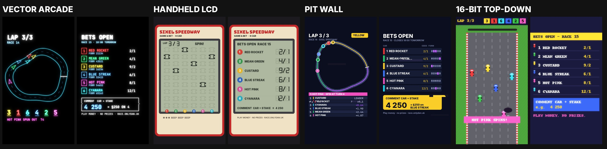

# Third channel: Sixel Speedway, retro car racing you bet on

Plan only, no code yet. This is a daily ~35 s vertical video of a simple, retro-looking car race
with synth sound only and no voice. It runs entirely on the server: there's no AI step and no
weekly routine. **The v1 look is still being chosen** (see "Design directions"). The teletext
style is parked for a v2 or a separate channel, so it doesn't tread on a friend's teletext horse
racing game. Each video:

1. **Hook**: one line about the race that's about to run ("§48,200 riding on one race").
2. **Race**: the race everyone bet on under the *previous* video, with simple cars.
3. **Result**: who won, the odds, how many backed it, the biggest win.
4. **Next race card**: six cars, odds and form. Viewers bet by commenting, e.g. `4 250`.

Everyone starts with **§1,000** of play money the first time the bot sees them. Balances persist,
every known player gets a **weekly bonus**, and once a week (Sunday) the video adds a **league table**.

**Name: Sixel Speedway.** "Sixel" comes from the teletext mosaic block, but it reads as
"pixel-ish" with any retro look, so it works for every direction below. A quick web search found
no game using the name, but that wasn't a trademark search. RACEFAX was dropped because an
existing horse racing game uses it. No Ceefax or BBC branding.

**Bets domain: `race.onlydan.uk`** (a spare domain for now; a dedicated one can replace it later
by changing `RACING_DOMAIN`, with the old one redirecting).

## Design directions for v1

Four directions, each drawing the same moment (lap 3 of race 14, Hot Pink has just spun) and the
same race card, so they compare like for like. Rendered by
[`racing/styles.py`](racing/styles.py), a throwaway sketch.



| | Look | Race view | Its "glitch" | Sound | For | Against |
|---|---|---|---|---|---|---|
| **A. Vector arcade** ([race](racing/styles/a-vector-race.jpg), [card](racing/styles/a-vector-card.jpg)) | 1979 vector monitor: glowing coloured lines on pure black, wireframe cars, mono type | a whole circuit from above, cars as glowing arrows with beam trails | beam wobble, a row jumping sideways, phosphor ghosting | sine/saw bleeps, Asteroids-style thumps | striking and rare on Reels; cheap to draw; reads well small; the closest to the teletext energy without being teletext | needs pace in the motion (a static circuit looks empty); thin lines suffer from compression, so the lines need to stay thick |
| **B. Handheld LCD** ([race](racing/styles/b-lcd-race.jpg), [card](racing/styles/b-lcd-card.jpg)) | a 1980s pocket LCD game: grey-green glass with the unlit segments faintly visible, a printed colour faceplate, 7-segment odds | 6 lanes × 9 fixed positions; cars jump a segment at a time | slow-pixel smears, a dying-battery fade, segments stuck on | piezo beeps only, which suits "no voice" perfectly | instantly nostalgic; very legible; jerky segment motion is charming rather than cheap; the faceplate is a natural brand space | the least "race-like" motion; it gets harder to show overtakes and spins; a muted palette is less thumb-stopping |
| **C. Pit wall** ([race](racing/styles/c-pitwall-race.jpg), [card](racing/styles/c-pitwall-card.jpg)) | a modern TV timing screen: dark navy, timing tower with gaps, sector colours, flags | live track map with numbered dots; the tower reorders on overtakes | broadcast dropouts: macroblocking, a frozen strip, "SIGNAL LOST" | data bleeps, a whoosh on each overtake, a synth bed | the best fit for *betting*: gaps, form chips and flags give viewers something to read; feels serious and fair | not retro, and closest to the real F1 TV look (keep it generic, no F1 marks); dots are less fun than cars |
| **D. 16-bit top-down** ([race](racing/styles/d-16bit-race.jpg), [card](racing/styles/d-16bit-card.jpg)) | a 1990s console racer: pixel-art sprites, kerbs, tyre walls, a pixel font, light scanlines | a scrolling straight seen from above, as in the teletext mock-up but in pixel art | sprite flicker, a scrolling hiccup, a palette flash | chiptune engines, a 4-channel bed | the most "game"; sprites can show spins, smoke and oil properly; easy for everyone to read | a crowded genre; pixel art needs care (sprites, tiles) to look good rather than cheap |

**Recommendation: A (Vector arcade)**, with C's timing tower as the info layer on the race card
and result. A is the most distinctive, keeps the glowing-screen, synth-and-glitch feel you liked
in the teletext version, and is no harder to render. B is a strong second if you'd rather lean
into nostalgia. They could also be combined later: the parked teletext look as v2, or as a "retro
night" special.

The original teletext mock-ups are kept in [`racing/screens/`](racing/screens/contact-sheet.jpg)
(drawn by [`racing/mockup.py`](racing/mockup.py)) for the v2 or separate channel.

## 1. Decisions to make (recommendations first)

| # | Question | Recommendation |
|---|---|---|
| 1 | Name and accounts | **Decided: Sixel Speedway.** Instagram only at launch, like the adventure channel. Add YouTube Shorts later; it's a per-channel `platforms` switch. Balances are per platform account (an Instagram and a YouTube account can't be linked). |
| 2 | Cadence | **Decided: daily at 19:00** Europe/London. Bets close **18:00 the next day**, and the video renders right after. Chosen to keep clear of the other channels' work (adventure counts votes at 08:00 and posts at 09:00; the quiz posts at 12:00), so renders never overlap. |
| 3 | Which comment counts | **Decided: every comment is its own bet.** Three comments `4 250`, `2 100`, `6 50` are three bets. They're taken in the order they were posted until the balance runs out (§3). One comment = one bet; a comment naming two cars is rejected. |
| 4 | Bet with no amount (`4`) | **§100**. Stakes over the balance are cut to the balance. `all` / `all in` stakes everything. The minimum is §10. |
| 5 | Weekly bonus | **Decided: every Sunday, every known player gets §100, plus §50 for each video they commented on that week.** This replaces the relief fund: nobody stays bust for long, and commenting is rewarded. |
| 6 | League table | **Decided: all-time balance, top 10, on Sundays**, plus a "climber of the week" line so new players have something to win. |
| 7 | Telling people their balance | **Decided: the bot replies to every bet** with what it took and the balance left, and points at **the bets domain** (§7). The domain is the only place with name lookup, bet history, the league table and each race's seed check. Replies are paced and worded a few ways so Instagram doesn't treat them as spam (§3). |
| 8 | Provably fair | **Decided: yes.** The caption carries `race 15 seal: 3f9a…` (a SHA-256 of the secret seed), and the next caption reveals the seed. Anyone can re-run the race with the open code. It's cheap and it answers "it's rigged". |
| 9 | Cars | **A fixed roster of six**, one per colour: 1 RED ROCKET, 2 MEAN GREEN, 3 CUSTARD, 4 BLUE STREAK, 5 HOT PINK, 6 CYANARA. They become characters, and their form means something. White is kept for a guest or "ghost" car on special days. |

## 2. The video (~35 s, ~40 s on Sundays)

| t (s) | Scene | What happens | Sound |
|---|---|---|---|
| 0.0–0.6 | — | Snow and a tuning sweep snap into the page; this matches the end frame, so a replay loops seamlessly | white noise, carrier whine |
| 0.6–3.0 | Hook | **Hook**, big type, built up a line at a time | blips as it builds |
| 3.0–5.5 | Grid | Grid. Five red lights come on one by one, then go out | 5 beeps + a long one |
| 5.5–21 | Race | **Race**, 3 laps (a whole circuit or a scrolling straight, depending on the style). Order tiles reshuffle on overtakes; event banners (SPIN, TURBO, PIT, BLOWN ENGINE); a glitch burst at each big moment | one detuned saw "engine" per car, pitch follows speed; noise crowd |
| 21–23 | Finish | Chequered flag. On a close finish, a "PHOTO FINISH" freeze with a zoom | crash cymbal (noise) |
| 23–28 | Result | **Result**: winner, odds, podium, how many backed it, the biggest win (@name), bust count | chiptune fanfare |
| (Sun) +5 | Table | **League table** | jingle |
| 28–35 | Card | **Race card** for the next race and how to bet; holds long enough to read | an original synth loop in the chosen style |
| 35 | — | Picture collapses to a dot and goes to snow (the same frame as 0.0) | power-off thunk |

**Hooks** come from templates filled from the race data; no AI is needed. We already know the
result when rendering, so the hook can set up the payoff without giving it away:

- `§{total} RIDING ON ONE RACE` · `ONLY {n} OF YOU BACKED THE OUTSIDER` (when an outsider wins)
- `@{a} VS @{b}: §{x} ON RIVAL CARS` (the two richest players backed different cars)
- `{fav} HASN'T LOST IN {k} RACES` (when the streak is about to end, or not)
- `{n} OF YOU WENT ALL IN`

Every template is true either way, so the hook never lies about the outcome.

## 3. The game

- **Players**: a player is created the first time the bot reads a comment from them, keyed by
  platform + account id, with the handle saved for display. They start with §1,000.
- **Betting**: comment under the latest video. **Every comment is a separate bet**, so backing
  three cars takes three comments. The bets are taken in the order they were posted: each stake is
  cut to whatever balance is left, and once it's at zero, later comments that day don't count. A
  comment deleted before the cutoff is no bet (on YouTube, an edited one counts as it reads then;
  Instagram comments can't be edited).
- **Bet replies**: the server checks the open post for new comments every 15 minutes until the
  cutoff and replies under each bet, for example:
  > ✅ §250 on 4 BLUE STREAK at 6/1. §750 left. Every bet and balance: race.onlydan.uk
  - A stake cut to the balance says so: "Only §120 left, so it's §120 on 4 BLUE STREAK at 6/1."
  - With nothing left: "No § left for race 15. Sunday's bonus is §100 plus §50 for each video you
    comment on."
  - A comment that looks like a bet but doesn't parse (a number and something car-like) gets one
    "Didn't catch that: comment a car and a stake, like `4 250`" per player per race. Ordinary
    chat gets no reply.
  - A bet under an older video after its cutoff gets "Betting on race 14 has closed; today's video
    takes bets on race 15", once per player.
  - Opted-out viewers get no reply, and their comments aren't read.
- **What a reply guarantees**: the reply's balance is worked out from the bets seen so far, in
  comment order. Settlement at the cutoff is the real thing: it re-reads everything in posting
  order, so a comment the API returned late or a deleted bet can change it. The race page on the
  domain shows the final word. Odds are fixed when a race opens, so the odds in a reply never
  change.
- **Pacing**: replies go out through a queue, a few seconds apart, with an hourly cap
  (`RACING_REPLY_PER_HOUR`). Each kind of reply has several wordings, because many identical
  replies look like spam. Instagram comments can't carry clickable links, so the domain is plain
  text there; on YouTube it's a link. If the cap is reached, the rest of the bets still count;
  they just don't get a reply. The parser is in the style of
  `app/adventure/votes.py`, and it accepts `4 250`, `#4 250`, `250 on 4`, `car 4 £250`,
  `blue streak 300`, `all in on 3`, `4 all` and `4` (= §100). It rejects anything that names two
  cars, or a number with no clear car.
- **Weekly bonus** (Sundays, before the league table is drawn): every known player gets **§100**,
  plus **§50 for each video they commented on** that week, any comment, bet or not (likes can't be
  read per person). "Known" means not opted out and not anonymised. Players who stop playing
  still collect the §100 for up to 90 days, until they're anonymised (§8). That's worth
  watching, because an idle player can drift up the table while active players lose bets.
- **Odds**: fractional (British bookie style, 9/2), from the race simulation (§4) run 20,000 times
  with random seeds. They're priced with a **5% margin**, which slowly drains the money supply so
  balances don't inflate forever. Payout = stake × odds + stake. Win bets only at launch;
  each-way could come later.
- **Settlement**: at the cutoff, the server reads the comments, takes every valid bet in comment
  order, debits the stakes, runs the sealed race, credits the winners and renders. Everything goes
  into an append-only **ledger** (`bet`, `payout`, `bonus`, `starting_balance`), and balances are
  derived from it. This means we can audit any dispute, and erasure is one filter.
- **Form**: each car has hidden pace, consistency and reliability. They drift a little after every
  race (a seeded random walk), so the form guide and odds change and there's something to read
  into. The roster never changes, so the cars build a history.

## 4. Race simulation and fairness

- A deterministic tick simulation (30 Hz, about 15 s of race time). Each car's speed is pace + noise
  × consistency. Seeded events: oil slick spin (−speed for 1 s), turbo (+speed), pit stop, and a
  rare blown engine (DNF, which reliability makes less likely). Overtakes come out of the
  simulation and are never scripted, so the video shows exactly what the simulation produced.
- **Seed**: generated when betting opens and stored privately. The caption publishes
  `sha256(seed ‖ race_no ‖ car_stats)`, and the next video's caption reveals the seed. The race
  can't be changed after the bets are seen, not even by us.
- The odds come from the same simulation run over random seeds, so a 9/2 car really does win about
  1 in 5.5 (less the margin). A test checks the calibration.
- The rendered race is the simulation replayed: car y = distance, scaled to the visible straight,
  with the camera following the leader. A lap is one scroll of the straight. There is no fake
  oval; the lap counter and order tiles carry the story.

## 5. Look

The style is open (see "Design directions"). These rules hold whichever one wins:

- **Six colours, always the same per car** (red, green, yellow, blue, magenta, cyan), and the car
  number is always shown next to the colour, for colour-blind viewers.
- **Safe area**: text stays inside **x 48–936, y 240–1440** of the 1080×1920 frame. Above that
  is the Reels header, below is the caption and buttons, and to the right are the like and
  comment buttons. Scenery can run under the overlays.
- **Glitches** are events rather than constant noise: a burst of 2–4 frames on the hook, on
  overtakes, and on result reveals, plus the odd random one. Each style has its own kind (see the
  table). They can cross any text, including the race card: a burst lasts a split second and the
  text is readable again straight after.
- **Compression**: per-frame noise wrecks the bitrate (the teletext motion test was 12 MB for 4 s
  at CRF 20). Use fixed textures that shift rather than fresh noise per frame, keep lines at least
  4 px thick, and encode at a capped bitrate.
- **Fonts** are bundled open-licence files (OFL or public domain), as with the other channels.

## 6. Sound (synth only, no voice)

Built on `app/render/audio.py` / `music.py` (numpy synthesis, already used for the quiz):

- **Engines**: one detuned saw per car, low-passed, pitch from speed, panned by lane. It gets
  louder for the leaders.
- **Interface noises** (in the chosen style's voice): blips as screens build, a power-on sound, a click on each scene change.
- **Start**: five 440 Hz beeps and one 880 Hz.
- **Events**: spin (falling sweep), turbo (rising sweep), blown engine (noise burst), crowd (pink
  noise swell at overtakes and the finish).
- **Bed**: an original jazz-funk / chiptune loop under the result and race card, varied per video
  from the seed (as the quiz's synth music is), with no licensing.
- **Volume**: mixed to about −14 LUFS.

No ElevenLabs credits are spent, so this channel doesn't touch the shared voice budget.

## 7. How it fits this repo

It's a new channel and content kind, alongside `main` (quiz) and `adventure`:

```
channels.py      RACING = "racing" → Channel("racing", "Sixel Speedway", "racing", settings.racing_handle, "19:00", …)
app/racing/
  sim.py         seeded race sim, Monte-Carlo odds, car stat drift, seal/reveal
  bets.py        comment → (car, stake) parser (pattern of adventure/votes.py)
  replies.py     bet replies: wording variants, paced queue, hourly cap
  ledger.py      players, append-only ledger, balances, settle(), weekly bonus, league table
  hooks.py       hook templates chosen from race data
  jobs.py        the daily cycle (pattern of adventure/jobs.py)
app/render/racing/
  style.py       the chosen look: palette, fonts, car and track drawing
  crt.py         CRT + glitch pass (precomputed remap/masks; or ffmpeg filters)
  scenes.py      boot, hook, grid, race, flag, result, table, card, power-off
  sound.py       engines, blips, events, bed
DATA_DIR/racing/ players.json · ledger.jsonl · races/{n}.json (seed, stats, bets, result)
```

**Daily cycle** (all on the server's scheduler, with no AI step):

```
every 15 min while race N is open: read new comments on video N-1 → reply to bets (queue)
18:00  close betting on race N: read comments on video N-1 (cliffhanger.read_comments)
       → parse bets → new players get §1,000 → debit stakes
       → run race N from its sealed seed → settle → pick hook
       → open race N+1: drift car stats, new seed + seal, Monte-Carlo odds
       → render (hook · race N · result · [Sunday table] · card N+1) → Discord preview
19:00  post the Reel; caption has race N's seed reveal + race N+1 seal + "comment CAR STAKE"
       → comment link on the previous post (existing link_previous)
Sunday 18:00, before settling: weekly bonus → league table page added to the video
```

**Already in place and reused**: the scheduler, render lead time, deploy lease and restart
recovery (`pipeline.py`), per-channel tokens and publishers, comment reading, opt-out list,
Discord previews and failures, `/jobs/failed` + retry, metrics and dashboard, the home page and
legal pages (built from the channel registry, so the new channel is listed automatically).

**New endpoints** (main domain, token): `POST /racing/start` (open race 1), `GET /racing/state`,
`GET /racing/races/{n}`, `GET /racing/players?q=`, and `POST /racing/dry-run` (render tomorrow's
video from today's comments without settling anything).

**The bets domain**: a second domain, `race.onlydan.uk`, points at the same Easypanel app.
A small middleware checks the `Host` header against `RACING_DOMAIN`:

- On the bets domain, **only** the racing public pages exist, and everything else is a 404 there
  (no dashboard, no API, no quiz pages). The pages are `/` (league table and this week's race
  card), `/p/{handle}` (balance, bets, bonuses), `/race/{n}` (result, every bet, and the seed check:
  the revealed seed, its fingerprint, and the published fingerprint side by side), and its own
  `/privacy` and `/terms` (the same policy text, branded for the channel).
- On the main domain, none of those pages exist, so the quiz brand and the game stay separate.
- Opted-out players never appear; anonymised players show as "punter #1234".
- It's read-only and needs no sign-in: balances come from public comments anyway. The handle
  lookup matches exactly, so it can't be used to search for people.
- Easypanel needs the extra domain added to the app and a certificate. That's the only
  infrastructure change.

**Renderer language**: **Python** (PIL + numpy), not the adventure's TypeScript/Skia. Every
direction is lines, rectangles and sprites, and the existing quiz renderer, ffmpeg piping and synth
are already Python. The mock-up's CRT pass takes about 0.8 s a frame, which is too slow for
~1,050 frames. The fix is to precompute the barrel remap, scanline, grille and vignette as one
multiplier, bloom at quarter resolution, and use 4 worker processes. The target is under 2
minutes a video; if numpy can't get there, the CRT moves to an ffmpeg filter chain
(`lenscorrection`, `gblur` + `blend`, `geq` scanlines).

## 8. Rules, privacy, platforms

- **Not gambling**: it's play money with no purchase, no cash value and **no prizes**. Under the
  UK Gambling Act 2005, betting needs a prize of money or money's worth, so there isn't one. We
  never attach real prizes (even merch) without legal advice, because that turns it into a prize
  competition or lottery. "PLAY MONEY. NO PRIZES." is on every race card and in every caption.
- **Platform policy**: Instagram and YouTube restrict content that *promotes real gambling*.
  Simulated betting with play money is fine organically. We never mention or link bookmakers or
  casinos, and we never run it as a paid ad without checking the ads policies (Meta treats
  "social casino" ads as restricted).
- **Privacy**: names on screen and a balance per account are new personal data. Additions to the
  privacy policy: bets, balances and the ledger, why (to run the game the player opted into by
  commenting), and retention (kept while they play; anonymised after **90 days without a bet**,
  in line with the existing 90-day rule). `#optout` removes them from the table and stops reading
  their comments; erasure deletes their ledger rows. The existing explainer page gets a third
  video ("how your bets work").
- **Ages**: there's no age gate (it's play money). The tone and copy stay clear of real-money
  gambling language: no "odds boost", "free bet" or "cash out".

## 9. Milestones

| | Deliverable | Done when |
|---|---|---|
| M1 | `app/render/racing` in the chosen style: all scenes from fixture data; `render_cli.py --racing fixture.json` | a 35 s video renders in < 2 min; golden-frame tests; the safe-zone test checks every text box |
| M2 | `racing/sim.py`: sim, events, stat drift, seal/reveal, Monte-Carlo odds | determinism test (same seed = same race); odds calibration test |
| M3 | `racing/bets.py` + `ledger.py`: parser, settlement in comment order, weekly bonus, league table | parser table tests (accepts/rejects); ledger replay = balances |
| M4 | Sound | engines, events and bed mixed; −14 LUFS |
| M5 | Channel wiring: `channels.py`, `jobs.py`, endpoints, Discord previews, dry run | a week of dry runs on fake comments, posting off |
| M6 | Bet replies (15-min comment check, paced queue, wording variants), bets domain (host-checked middleware, lookup, race pages with seed check, its own privacy/terms), privacy policy + explainer | other paths 404 on the bets domain; racing pages 404 on the main one; opt-out works end to end |
| M7 | Launch (§11): add `race.onlydan.uk` in Easypanel, connect the account; post **Race 0**, a rules video ("comment a car and a stake, you start with §1,000"); race 1 the next day | the first real settlement posts |

## 10. Risks

- **Comment reach**: the game is only as fair as the comments we can read. `GET /comments/check`
  already compares what the bot reads with the post's comment count; we run it on Race 0 before
  relying on it, and replies to other comments (bets typed as a reply) are read too.
- **Bets that fail to parse**: a "Didn't catch that? Use CAR STAKE, e.g. `4 250`" line on the race
  card, and a weekly Discord list of comments that looked like bets but didn't parse, so the
  parser improves.
- **Whales and all-ins** dominate the table. That's acceptable, and it's part of the drama. The
  climber line and the weekly bonus keep new players interested.
- **Reply limits**: Instagram doesn't publish a reply rate limit, and a new account replying a lot
  can be restricted. Start with a low hourly cap, watch for "action blocked" errors (they go to
  Discord and pause the queue for an hour), and raise the cap slowly. Bets never depend on replies.
- **Comment spam for the bonus**: §50 is per *video* commented on, not per comment, so ten comments
  on one video still earn §50. Bets are what multiple comments are for.

## 11. Launch and the first few weeks

A brand-new account gets few views and fewer comments, so the first posts have to work with zero
or a handful of bets (the adventure channel had the same problem):

- **Race 0** is a rules video: "comment a car and a stake, you start with §1,000, the race runs
  tomorrow". Race 1 the next day settles its bets. The first video of every week repeats the rules
  in one line.
- **Everything has a zero-bets version.** The race always runs. Hooks that don't need bets come
  first ("CUSTARD HASN'T LOST IN 3", "PHOTO FINISH LAST TIME"). With no bets, the result says
  "Nobody backed CUSTARD at 12/1. Be the first: comment `3 100`" instead of a biggest win. The
  league table waits until there are 5 players and shows "the table opens at 5 punters" until then.
- **The first comment is the bot's own**: an example bet ("Comment like this: `4 250` = §250 on
  BLUE STREAK"), the way the adventure channel posts its options. It shows the format where people
  look, and a post that already has a comment gets more comments.
- **Every early bet gets a reply** (the reply cap won't be reached for a while), which is the best
  sign that someone is listening.
- **Launch bonus**: for the first four weeks, the weekly bonus is doubled (§200 plus §100 per video
  commented on), to reward the first players for sticking around.
- **Cross-promotion**, done by hand: a story from the quiz and adventure accounts on launch day.
  Nothing automatic posts about other channels.
- **Don't judge the first fortnight.** Comment counts (from `/metrics`) are the measure; the hook
  templates and how long the race card stays up are the first things to adjust.
- **No house players.** Fake punters would make the table look busy, but they'd be fake comments
  in a game sold on fairness.
